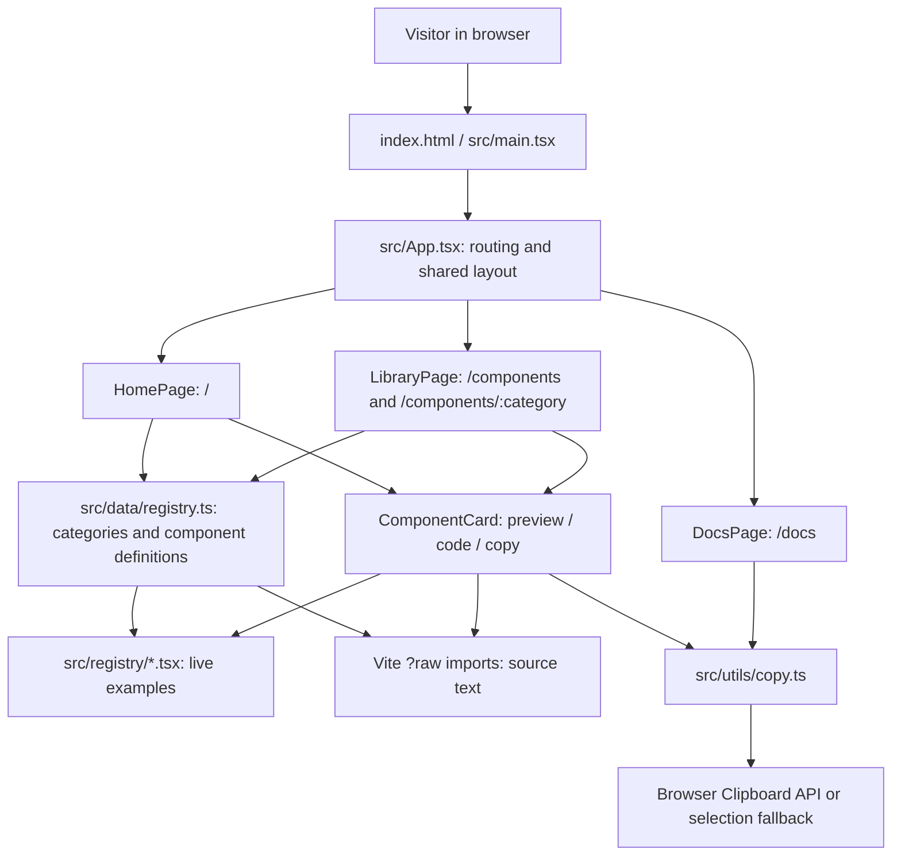
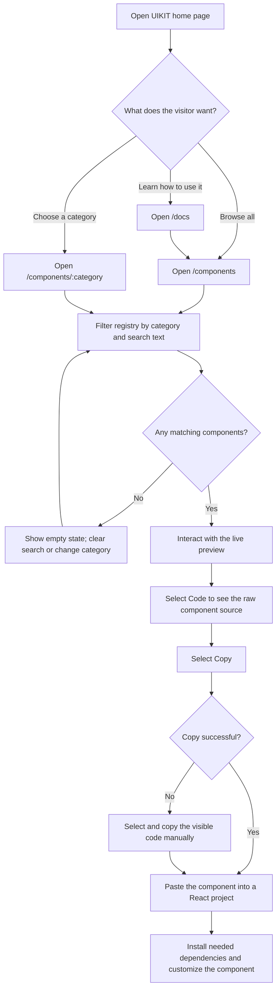

# UIKIT Architecture and Flow Diagrams

UIKIT is a frontend-only gallery of interactive, copy-paste-ready React components. Visitors can browse examples, try live previews, view their source, and copy that source into their own projects. There is no backend, database, or account system.

## Project Structure

| Path | Responsibility |
| --- | --- |
| `src/main.tsx` | Mounts the React app and loads global CSS. |
| `src/App.tsx` | Selects the page from the URL and renders the shared header and footer. |
| `src/pages/Home.tsx` | Landing page, category links, and featured examples. |
| `src/pages/Library.tsx` | Category navigation, client-side search, and filtered results. |
| `src/pages/Docs.tsx` | Instructions for installing dependencies and using a component. |
| `src/data/registry.ts` | Source of truth for categories and components: metadata, live component references, and copyable source strings. |
| `src/registry/*.tsx` | Standalone interactive component examples. |
| `src/components/showcase/` | Shared gallery UI, including preview/code switching in `ComponentCard.tsx`. |
| `src/utils/copy.ts` | Clipboard helper with a fallback for browsers where the Clipboard API is unavailable. |
| `src/index.css`, `public/images/` | Site styling and static imagery. |
| `tests/catalog.spec.ts` | Playwright tests for the catalog and its interactions. |

## Architecture Diagram

**How the registry works:** Each entry in `src/data/registry.ts` connects a category and descriptive metadata to both a React component for the live preview and a `*.tsx?raw` import of that file for the Code tab. Vite includes the source text in the frontend build; browsing and searching do not require an API request. Category counts are derived from the registry rather than maintained separately.

## Visitor Flow Diagram

Search runs in the browser against component names, descriptions, categories, and labels. The library narrows those results to the selected category when applicable. `ComponentCard` switches between the running example and its source, then shows copied/error feedback after using `copyText()`. That helper tries the Clipboard API first and falls back to text selection with `execCommand("copy")`.

## Adding a Component

1. Create a self-contained example in `src/registry/`.
2. Import the component and its `*.tsx?raw` source in `src/data/registry.ts`.
3. Add its metadata and category to the `components` array. If the category is new, also update the `CategoryId` type and `categories` array.
4. Check its live preview, Code tab, copy behavior, keyboard access, and responsive layout.
5. Run `npx tsc --noEmit`, `npm run build`, and `npx playwright test`.

The deployed site is a client-side application. Configure static hosting to serve `index.html` for routes such as `/components/buttons` when users load them directly.
